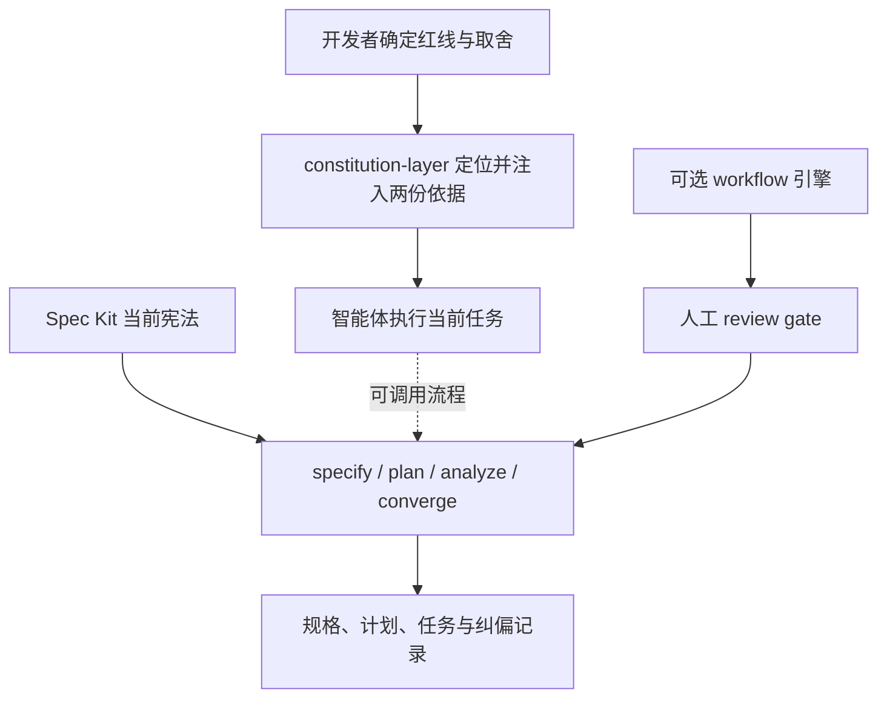

**Spec Kit 与 constitution-layer 对比报告**

调研日期：2026-11-01。

对比基线：

- Spec Kit：`github/spec-kit` 的 `main`，提交 [`7370e59`](https://github.com/github/spec-kit/tree/7370e592f3cd9c06e5b698983957e227c75b30e2)，提交时间 2026-10-30；该提交的 `pyproject.toml` 版本为 `1.2.6.dev0`，不等同于最新正式发行版。
- constitution-layer：当前工作区，提交 `3ba572d52be3ad5845f0903d2f7b5f93406c0bd7`，包版本 `0.2.0`；调研开始时工作区干净。
- 阅读范围：上游 29 份关键文档、命令模板与适配代码；本项目的 README、宪法、心智模型、技能及其判据、两条注入实现、平台清单和三个测试文件。本文属于架构与产品能力对比，不是上游全仓审计。

**一、主要结论**

**两者有明显交集，也有可组合的空间。Spec Kit 已覆盖项目宪法与开发流程治理；constitution-layer 的独立价值主要在开发者掌握立场、红线与决策轴分离，以及宿主运行时持续提供判断依据。**

具体判断：

1. **“项目需要宪法”不是本项目相对 Spec Kit 的新能力。** 上游已有创建与更新宪法、规划前后检查宪法、跨产物分析、实现收敛检查和修订治理。
2. **不能把 Spec Kit 概括成只管“怎么做”。** 当前主分支还提供独立的想法评估扩展，对问题真实性、证据、战略匹配和风险作出 `go / needs-clarification / kill` 判断。
3. **本项目更明确地规定了价值判断的来源。** Spec Kit 默认允许智能体根据仓库上下文推断并起草原则；本项目明确要求开发者确定立场，智能体只引导与检查。这是实际的默认行为差异。
4. **双文件是治理结构上的选择，不能直接当作不可替代的能力。** Spec Kit 的可定制宪法也能表达取舍偏好；你的设计把否决与排序分开，使权威关系更显式，但其收益还需要行为评估证明。
5. **建议保持小范围的判断依据层，并提供与流程工具组合的方式。** 扩张为第二套规格、计划、任务和工作流平台，会削弱当前定位，并与本项目“组合、不复制”的原则发生张力。

**二、能力对照**

| 维度 | Spec Kit 当前主分支 | constitution-layer 当前实现 | 判断 |
|---|---|---|---|
| 产品范围 | 面向编码智能体的流程工具包；核心 SDD，另有 Bug 修复、想法评估及可组合机制 | 项目专属判断依据插件 | 范围不同，不能用功能数量直接判胜负 |
| 项目宪法 | `.specify/memory/constitution.md` | 根目录 `CONSTITUTION.md` | 核心概念重叠，路径不同 |
| 决策取舍 | 可在原则、约束和治理章节表达；默认模板不单列心智模型 | 独立 `MENTAL-MODEL.md`，显式低于宪法 | 本项目结构更明确，上游可定制实现相近语义 |
| 原则来源 | 接受用户输入，也允许从现有仓库推断并起草 | 开发者决定方向；智能体不得代笔条款 | 最鲜明的默认政策差异之一 |
| 使用时机 | 相关命令读取当前宪法；扩展可接生命周期事件 | DSH 每次提示词装配重新解析；CodeBuddy 在匹配的 SessionStart 事件注入 | 本项目更聚焦跨任务持续提供依据 |
| 建立依据的缺失处理 | 随命令而异；`specify` 在存在时加载，`converge` 对未填写模板可跳过宪法检查 | 缺任一文件或文件为空时提示先建立依据 | 本项目立场更严格，但机制仍是提示 |
| 想法是否值得做 | `assess` 扩展有证据收集、问题定义、方案塑形与决策产物 | 引导开发者明确定位与红线；没有独立证据评估流水线 | 不能宣称上游不管“该不该做” |
| 规格到实现 | spec → plan → tasks → implement → converge | 不自行实现这条流程 | 上游覆盖明显更完整，符合双方定位 |
| 审查与可追溯性 | 需求标识、覆盖表、严重级别、来源引用及追加纠偏任务 | BLOCKER / MAJOR / NIT，要求引用触犯的规则；没有统一的任务映射产物 | 值得借鉴上游的证据格式 |
| 宪法修订 | 语义版本、批准与修订日期、治理规则、变更影响报告 | 显式人工授权；Git 留存文件变更 | 本项目有权限政策，缺少结构化修订记录 |
| 提示与执行门禁 | 命令中的语义检查依赖智能体；可选 workflow 有引擎管理的 gate 与暂停恢复 | 不拦截工具；缺文件不形成工具级阻断 | 必须区分提示规则、流程门禁和工具权限 |
| 生命周期扩展 | Extension runtime events，经适配器映射到原生事件 | 直接对接 DSH section 与 CodeBuddy SessionStart | 生命周期钩子本身不是独有能力 |
| 平台覆盖 | 多种适配器，包含 DSH、CodeBuddy、Codex、Claude 等；能力随适配器变化 | 原生接线集中于 DSH、CodeBuddy / WorkBuddy；Claude 未实机验证 | 本项目覆盖更窄，但 DSH 接入层次更深 |
| 分发与定制 | Python CLI、integrations、extensions、presets、workflows、bundles、catalogs | Node 插件、DSH bundle、CodeBuddy 插件市场 | 复杂度与目标受众不同 |
| 自动化验证 | 上游存在多类测试与 CI；本次未运行其套件 | 本次实跑 40 项测试全部通过 | 已验证机制可靠性的一部分，尚未验证判断质量 |
| 许可证 | MIT | MIT | 没有许可证层面的组合障碍；具体复用仍需保留相应声明 |

**三、核心设计差异**

**1. 宪法在流程中的位置**

上游的默认使用方式是把宪法作为流程命令的治理输入。`plan-template.md` 明确要求研究前检查、设计后复查；`analyze` 将宪法冲突列为 CRITICAL，并要求修改规格、计划或任务，不能在分析中稀释宪法；`converge` 进一步检查代码是否满足意图与宪法，并追加可追溯的修复任务。[S2][S3][S4]

你的插件则先解决另一件事：即使当前任务没有进入某个规格命令，也尽量让判断依据存在于智能体上下文中。DSH 通过 `systemPrompt.section()` 的函数式 `text` 接入，每次装配重新解析适用范围并读取当前内容；文件正文有基于修改时间和大小的缓存。它不是只在第一次启动时读取一次。[L1][L2]



图中虚线只表示可组合关系。当前仓库没有实现与 Spec Kit 的桥接；两份宪法的来源、路径和权威关系也尚未统一。

**2. 人决定立场，与智能体起草原则**

Spec Kit 的宪法命令明确允许：用户没有给出占位符值时，从 README、文档和既有宪法中推断，然后起草并写回。这种默认方式降低了建立文档的成本，但可能把既有实现习惯固化成应当遵守的原则。[S1]

你的技能要求开发者先回答交付形态、使用对象、最不能做错的事和既有教训，再确定决策轴；不允许智能体替开发者确定条款。它更适合在价值立场尚未达成共识时，防止“生成了文档”被误当成“达成了共识”。[L3]

这里也有需要澄清的产品边界：技能同时写着“智能体不代笔任何一条”和“写入两个文件”。开发者确定含义后，智能体能否只整理措辞、逐字转录并提交确认，目前不够清楚。**决定内容、协助表述、执行落盘是三个不同权限，应明确区分。** 上游默认更宽松，你的默认更谨慎；两者都是可调整的政策，不代表只有某一方能保留人工控制。

**3. 红线与决策轴分离的价值与局限**

你的设计把决策分为两个步骤：

- 宪法排除不可接受的方案。
- 心智模型在剩余可接受方案中进行排序。

例如：如果宪法禁止上传用户原始数据，那么云端处理方案直接出局；如果两个本地实现都满足需求，再由“简单优先”决定是否值得引入额外依赖。

这比把禁止项、偏好和流程要求平铺在同一文档中更容易解释。但 Spec Kit 的宪法模板并不禁止表达优先级，也允许扩展章节，因此**文件分离的优势主要是可理解性、可审查性和默认使用习惯，不是上游无法表达这些规则。**

此外，本项目审查判据把“违反心智模型”也归为 BLOCKER。若“简单优先”只是一般偏好，就需要定义什么情况下构成违反；否则排序规则容易在使用中变成另一套绝对红线，削弱双文件分离的意义。[L4]

**4. 常驻注入不是全新的扩展原语，但 DSH 接线有实际差异**

Spec Kit 已经支持扩展声明 `session_start`、`pre_tool_use`、`post_tool_use` 等原生生命周期事件。事件执行命令模板关联的脚本，Markdown 指令本身不会被当作智能体提示执行；每个适配器只支持自己的事件子集。[S5]

因此不能把上游描述成“只能手工运行命令、没有自动事件”。但本次核对的 DSH 与 CodeBuddy 适配器都未声明原生事件映射；DSH 主要负责安装技能与调用 headless profile。其基类只有在声明事件映射和配置文件后才判为支持 events。[S6][S7]

你的 DSH 实现直接进入宿主提示词装配服务，这比上游当前 DSH 适配器深入；CodeBuddy 侧则明确注册 `startup|resume|clear|compact` 的 SessionStart 匹配。[L2][L5]

需要限定宣传范围：DSH 的每次装配重读、CodeBuddy 的匹配事件注入，是不同保证。二者都不等同于“模型一定遵守规则”，也不能据此推断所有平台、子会话和压缩行为都已实机验证。

**5. 上游在治理记录与闭环证据上更完整**

Spec Kit 的宪法命令包含语义版本、批准日期、修订日期和临时 Sync Impact Report；默认只写当前宪法，不改写版本化的模板来源。旧式的模板传播行为已经成为需要主动安装的 `constitution-sync` preset，不能把它说成当前默认行为。[S1][S8]

在执行闭环方面，`analyze` 提供需求到任务的覆盖分析，`converge` 要求发现项带 `source-ref` 与代码证据，且明确“任务勾选完成不等于证据”。这些机制让评审者能追溯“哪条义务没有满足”。[S3][S4]

你已有三档判据和引用规则的要求，但缺少统一、持久的规则到产物映射。这里最值得借鉴的是少量稳定的证据字段，而非复制上游整套文档体系。

**四、本项目的优势与当前缺口**

**已经落到代码和测试的优势：**

- 项目范围查找不越过最近的 `.git`，并能识别文件形态的 `.git` 标记；适合从子目录启动的场景。
- 空文件与纯空白不会被当作已经建立依据。
- 有开发者主动关闭机制，不把建议器包装成无法退出的门禁。
- DSH 使用 `interpolate: false`，避免用户正文中的 `{{...}}` 被当成宿主变量解释。
- 渲染异常降级为空串并告警，避免一份建议文本导致整个提示词装配失败。
- 有定位、注入注册以及双实现判据一致性测试；本次 40 项全部通过。[L1][L2][L6]

这些是有价值的工程细节，但不会自动证明“减少反问”“减少返工”或“模型更会判断”。现有测试主要验证文件与接线机制，摩擦日志尚无实际条目。[L7]

**本次发现的具体问题：**

| 优先级 | 问题与证据 | 影响 | 建议方向 |
|---|---|---|---|
| P0 | 宪法禁止自动增改；心智模型与审查判据却要求同类 BLOCKER 第二次出现时“直接把解决方案写进规则” | 宪法优先虽能裁决冲突，但模型仍会收到相反指令；“规则”是否包括宪法也没有限定 | 明确自动沉淀的目标与权限；涉及宪法仍须显式授权 |
| P0 | 技能正文说已有两份依据就进入常规流程，流程图却从“读取对照，不重写”连到“阶段一定位” | 可能导致每次重新访谈，与已有依据复用的目标相反 | 让正文与流程图使用同一套分支 |
| P1 | 技能“不要用于小改动”，又把“这次只是小改动”列为无效借口 | 容易混淆“读取并遵守依据”与“重新建立依据” | 分清始终适用的规则与仅初始化时触发的访谈 |
| P1 | 根目录退出标记会被更近的子目录判断文件提前截断，已实测 | README 的“该项目不再注入”在这一场景下不成立 | 明确根退出标记是否应覆盖整个 Git 项目，或允许局部重新启用 |
| P1 | 根宪法的身份仍以“在 superpowers 之上”为中心，README 与心智模型则强调独立可用 | 容易在未来接入其他流程时形成定位歧义 | 由开发者确认独立层与 superpowers 组合关系的正式表述 |
| P1 | Claude 仍是兼容性推断；仓库没有专用 `.claude-plugin` 清单，也没有本项目的 Codex 安装接线 | 使用者不能从技能格式通用直接推断可原样安装 | 按平台分别列出可安装、已测试、仅可复用技能的状态 |
| P2 | 两套平台独立维护定位与渲染逻辑，当前由 parity 测试缓解漂移 | 新边界场景可能两边一起漏掉，或只测判定未测完整文本 | 保留当前简单结构；先补真实缺口的共享场景，再判断是否值得抽取公共逻辑 |

P0/P1/P2 是本文建议的处理顺序，不代表已经修改了这些政策，也不替开发者裁决取舍。

第一项的原文分别见 [CONSTITUTION.md 第 23 行](D:/AICodeing/constitution-layer/CONSTITUTION.md:23)、[MENTAL-MODEL.md 第 52 行](D:/AICodeing/constitution-layer/MENTAL-MODEL.md:52) 以及 [review-criteria.md](D:/AICodeing/constitution-layer/plugins/constitution-layer/skills/constitution-brainstorm/references/review-criteria.md:15)。第二、三项见 [SKILL.md](D:/AICodeing/constitution-layer/plugins/constitution-layer/skills/constitution-brainstorm/SKILL.md:20) 的正文与第 159 行流程边。

退出标记问题的隔离验证场景是：Git 项目根目录存在两份依据与 `NO-CONSTITUTION.md`，子目录单独存在 `MENTAL-MODEL.md`。实际结果：

```text
从根目录解析：optedOut = true
从该子目录解析：optedOut = false，root = 子目录
从该子目录渲染：仍产生注入内容
```

原因是 `resolveScope()` 逐层遍历时，命中任一判断文件便返回，还没有机会检查更高层的退出标记。DSH 与 CodeBuddy 两套实现都采用这一顺序；现有测试覆盖同层标记优先，但没有覆盖“子层依据 + 根层关闭”。是否允许局部重启是政策选择，但当前文档没有表达这种例外。[L1][L5]

**五、建议借鉴的能力与实施顺序**

**第一步：先消除规则自身的歧义。**

优先明确自动沉淀的授权边界、已有依据时的流程、初始化技能与小任务的关系，以及项目级退出开关的作用范围。你的产品依靠模型理解规则，规则互相冲突会直接削弱核心价值。这比增加新平台或更多文档更紧迫。

本次实测文档篇幅为：宪法 48 行、心智模型 103 行，均在声明的 50 / 105 行上限内。问题主要是语义一致性，不是当前行数超标。

**第二步：建立最小的决策证据。**

借鉴上游覆盖表与 `source-ref`，让一次重要判断至少能回答：引用哪条规则、排除了哪个方案、剩余方案如何排序、有什么验证依据。可以先使用现有审查输出，不必立即建立新的永久文档类型。

对价值效果做有对照的行为评估，建议场景包括：

| 场景 | 观察内容 |
|---|---|
| 功能请求直接触碰红线 | 能否稳定指出具体规则并给出符合限制的下一步 |
| 两个方案都合法但存在取舍 | 能否应用决策轴，而非把普通偏好误判成绝对禁止 |
| 普通小任务且依据齐备 | 能否直接继续工作，避免重复访谈和不必要反问 |
| 两份规则矛盾 | 能否报告冲突与权威关系，避免自行修宪 |
| 恢复会话、压缩、文件修改 | 各宿主实际带入的是哪一版依据 |
| 项目退出及嵌套目录 | 能否符合开发者明确选择的作用范围 |

对比条件至少包含无本插件、只使用宿主项目指令文件、使用本插件三组；在相同模型与任务集下记录违规、误停和不必要提问。机制测试不能替代这部分评估。

**第三步：补充轻量的修订治理。**

借鉴上游的版本与变更说明，但保留人工决定立场的原则。最小需求是能辨认当前生效版本、修订原因和开发者批准的内容；不必一开始就复制完整的语义版本与模板同步系统。

不建议自动传播规则到多份模板。上游也已将这种行为移出默认流程，原因正是多份物化副本的漂移与维护成本。[S8]

**第四步：验证组合价值后，再接入 Spec Kit。**

上游已经提供 preset 的 `prepend / append / wrap / replace` 和 extension hooks，因此不必 fork 其核心命令。[S9] 但你的根文件路径与其 `.specify/memory/constitution.md` 不同，需要先明确权威来源。

一个符合当前定位的候选方案是：

- 由开发者指定唯一的宪法权威文件，避免维护两份独立事实来源。
- `MENTAL-MODEL.md` 保留为取舍依据，在相关命令中明确读取和引用。
- 通过 preset 或扩展桥接读取与审查，继续由 Spec Kit 管理 spec、plan、tasks 与 converge。
- 保留 DSH / CodeBuddy 原生注入路径，使本项目仍可独立使用。

这只是架构建议，**当前没有实现，也没有验证可直接安装的组合包**。尤其不能仅靠注册一个 `before_plan` hook，就宣称已经获得所有宿主的常驻注入能力。

**六、使用与发展方向的选择**

| 使用者的主要需要 | 更合适的选择 |
|---|---|
| 团队希望需求、计划、任务、实现验证有统一结构 | 优先评估 Spec Kit |
| 已有开发流程，只需要项目红线与取舍在宿主上下文持续可见 | constitution-layer 更贴合 |
| 同时需要规格闭环和人工掌握立场 | 两者组合有潜力，先解决权威来源与路径适配 |
| 需要跨很多智能体分发组织标准 | Spec Kit 的适配、preset 和目录体系更完整 |
| 明确需要工具权限层强制禁止某种操作 | 需要宿主权限或执行控制；本项目没有这项保证，Spec Kit 的人工 workflow gate 也不能概括成任意工具的语义执法 |

对你项目的定位建议是：**“由开发者确定项目红线与取舍，为编码智能体持续提供可引用的判断依据，可与现有开发流程组合。”**

这里最值得长期证明的，是同一套人类立场能否跨任务、跨会话稳定生效，并减少重复裁决的成本。常驻注入和双文件结构是实现手段；决策质量、可追溯性与人工控制的一致性才是产品结果。

**七、验证记录与结论边界**

- 本地运行 `npm test`：40 项测试，40 通过，0 失败；包括 foundation、插件注册和双实现 parity 测试。
- 用隔离临时目录调用当前 `resolveScope()` 与 `renderFoundation()`，复现根退出标记被子目录判断文件遮蔽的行为；验证后清理临时目录。
- 读取当前两份治理文档，确认分别为 48 / 103 行；没有改动宪法、心智模型、技能、实现或测试。本次新增物只有本报告。
- 上游按固定 SHA 阅读源码与文档，没有执行其测试、安装其 CLI，亦未在真实 DSH、CodeBuddy、Claude 或 Codex 会话中验证组合效果。
- 本文没有给出模型遵守率、性能、返工成本或使用满意度的量化结论；这些需要独立评估。

**八、关键证据索引**

上游链接全部固定在本次对比提交，避免后续 `main` 变化影响复核。

| 编号 | 来源 | 支撑内容 |
|---|---|---|
| S0 | [README](https://github.com/github/spec-kit/blob/7370e592f3cd9c06e5b698983957e227c75b30e2/README.md) · [pyproject.toml](https://github.com/github/spec-kit/blob/7370e592f3cd9c06e5b698983957e227c75b30e2/pyproject.toml#L3) | 当前产品范围与源码版本 |
| S1 | [constitution 命令](https://github.com/github/spec-kit/blob/7370e592f3cd9c06e5b698983957e227c75b30e2/templates/commands/constitution.md#L77) · [宪法模板](https://github.com/github/spec-kit/blob/7370e592f3cd9c06e5b698983957e227c75b30e2/templates/constitution-template.md) | 原则推断、起草、版本、日期及变更报告 |
| S2 | [计划模板的 Constitution Check](https://github.com/github/spec-kit/blob/7370e592f3cd9c06e5b698983957e227c75b30e2/templates/plan-template.md#L39) | 研究前与设计后检查 |
| S3 | [analyze 命令](https://github.com/github/spec-kit/blob/7370e592f3cd9c06e5b698983957e227c75b30e2/templates/commands/analyze.md#L56) | 只读分析、宪法权威与覆盖检查 |
| S4 | [converge 命令](https://github.com/github/spec-kit/blob/7370e592f3cd9c06e5b698983957e227c75b30e2/templates/commands/converge.md#L59) | 从实现证据发现缺口并追加可追溯任务 |
| S5 | [Extension runtime events](https://github.com/github/spec-kit/blob/7370e592f3cd9c06e5b698983957e227c75b30e2/docs/reference/extensions.md#L297) | 生命周期事件与命令 hook 的区别 |
| S6 | [DSH 适配器](https://github.com/github/spec-kit/blob/7370e592f3cd9c06e5b698983957e227c75b30e2/src/specify_cli/integrations/dsh/__init__.py) · [CodeBuddy 适配器](https://github.com/github/spec-kit/blob/7370e592f3cd9c06e5b698983957e227c75b30e2/src/specify_cli/integrations/codebuddy/__init__.py) | 两个平台当前接入方式 |
| S7 | [supports_events 判定](https://github.com/github/spec-kit/blob/7370e592f3cd9c06e5b698983957e227c75b30e2/src/specify_cli/integrations/base.py#L1095) | 适配器事件能力判据 |
| S8 | [constitution-sync preset](https://github.com/github/spec-kit/blob/7370e592f3cd9c06e5b698983957e227c75b30e2/presets/constitution-sync/README.md) | 默认运行时读取与可选模板传播的区别 |
| S9 | [Preset resolution](https://github.com/github/spec-kit/blob/7370e592f3cd9c06e5b698983957e227c75b30e2/docs/reference/presets.md#L344) | 不 fork 的命令组合方式 |
| S10 | [assess.decide](https://github.com/github/spec-kit/blob/7370e592f3cd9c06e5b698983957e227c75b30e2/extensions/assess/commands/speckit.assess.decide.md#L27) | 证据驱动的 go / clarify / kill |
| S11 | [内置 SDD workflow](https://github.com/github/spec-kit/blob/7370e592f3cd9c06e5b698983957e227c75b30e2/workflows/speckit/workflow.yml#L46) · [gate 输入语义](https://github.com/github/spec-kit/blob/7370e592f3cd9c06e5b698983957e227c75b30e2/docs/reference/workflows.md#L1420) | 人工审查 gate 与无交互时暂停 |
| L1 | [foundation.js](D:/AICodeing/constitution-layer/lib/foundation.js:109) | 查找范围、退出标记、缓存和渲染 |
| L2 | [index.js](D:/AICodeing/constitution-layer/lib/index.js:200) | DSH section、关闭插值和技能注册 |
| L3 | [constitution-brainstorm](D:/AICodeing/constitution-layer/plugins/constitution-layer/skills/constitution-brainstorm/SKILL.md:67) | 人工确定立场的引导流程 |
| L4 | [MENTAL-MODEL.md](D:/AICodeing/constitution-layer/MENTAL-MODEL.md:40) · [review-criteria.md](D:/AICodeing/constitution-layer/plugins/constitution-layer/skills/constitution-brainstorm/references/review-criteria.md) | 取舍、审查与规则沉淀政策 |
| L5 | [SessionStart 实现](D:/AICodeing/constitution-layer/plugins/constitution-layer/hooks/session-start.cjs:92) · [事件配置](D:/AICodeing/constitution-layer/plugins/constitution-layer/hooks/hooks.json:5) | CodeBuddy 注入时机和范围查找 |
| L6 | [foundation 测试](D:/AICodeing/constitution-layer/test/foundation.test.mjs) · [注册测试](D:/AICodeing/constitution-layer/test/index.test.mjs) · [parity 测试](D:/AICodeing/constitution-layer/test/parity.test.mjs) | 当前自动化验证范围 |
| L7 | [FRICTION-LOG.md](D:/AICodeing/constitution-layer/FRICTION-LOG.md) · [README](D:/AICodeing/constitution-layer/README.md) | 使用反馈记录与公开能力说明 |
