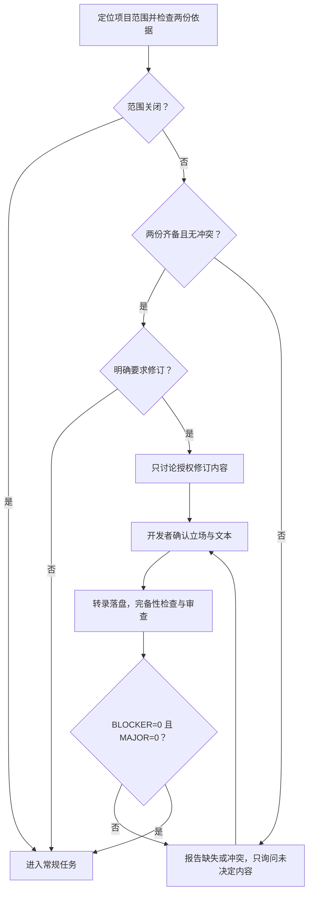

# 建立项目宪法与心智模型

宪法规定红线，心智模型为合法方案排序。立场由开发者决定，智能体负责引导、转录已确认文本与检查，不根据仓库习惯推断价值条款。

## 何时使用

项目缺任一判断文件，或开发者明确要求建立、修订依据时使用。
已有依据齐备且覆盖当前任务时，直接遵守并继续常规流程；小改动、明确 bug 不重复初始化访谈。
“小改动”不能成为忽略红线或在依据缺失时自行豁免的理由。

## 第一步：定位与检查

DSH 通过 prompt section 每次装配读取；CodeBuddy、Claude Code、Codex 通过 SessionStart hook 注入。
检查上下文中的两个标记 `--- BEGIN CONSTITUTION.md ---` 与 `--- BEGIN MENTAL-MODEL.md ---`，以及缺失提示。
只有一个 BEGIN 标记不代表齐备。两份都已注入且没有缺失提示时直接使用，避免重复读文件。
`<FOUNDATION-LOCATION>` 表明依据所在目录，`&lt;...&gt;` 是被转义的原始正文标记。

上下文没有注入或怀疑文件已更新时，按以下与插件一致的规则定位，不只检查当前目录：

1. 从工作目录向上扫描，记住遇到的第一组依据所在目录，但继续检查祖先退出标记。
2. 当前层存在 `NO-CONSTITUTION.md` 常规文件时，范围关闭，不注入、不提示、不初始化。
3. 扫描到最近的 `.git` 文件或目录（含当前层）即止；不跨越 Git 边界。
4. 未关闭时读取最近一组依据；不把子层宪法与父层心智模型拼成一组。无依据则在当前目录报告缺失。
5. 空文件、纯空白、不可读或同名目录视为缺失；外层退出标记不影响嵌套 Git 仓库。

| 状态 | 动作 |
|---|---|
| 范围关闭 | 直接进入常规任务，不再要求建立依据 |
| 两份齐备且适用于当前项目 | 对照任务使用，不重写、不重新访谈 |
| 缺任一 | 提示补齐，只询问缺失或未决定的内容，保留已有文件 |
| 有矛盾或归属不明确 | 引用具体冲突与位置，请开发者裁决，不自行合并或修订 |
| 开发者明确要求修订 | 只处理授权范围，保留其余立场，确认文本后落盘 |

插件是建议器，不拦工具。“停”是智能体执行的规则，不是宿主机械阻断。
开发者显式豁免时，在本次产出中说明；智能体不得为了消除提示创建 `NO-CONSTITUTION.md`。

## 引导：仅缺失或明确修订时进入

一次问一个问题，优先提供 2–4 个可比较选项，并允许开发者自定义回答。
不要将全部问题一次发出；已确认的答案不重复询问。

### 一、定位

按需确认：

1. 交付形态：自用、团队还是公开开源？
2. 给谁用、用来做什么决策？这一项未明确前不写条款。
3. 最不能做错的一件事是什么？
4. 已经出现过什么真实教训？

只收集实际立场，不根据代码现状把技术栈或既有习惯升级为红线。
本公共技能及其示例不得混入使用者的内部路径、真实业务数据与私有假设。

### 二、决策轴

呈现适用于项目的 2–4 条候选轴，由开发者选定方向与适用条件：

| 候选轴 | 需要确定的取舍 |
|---|---|
| 完备 / 速度 | 多验证一轮还是先交付可用部分 |
| 简单 / 灵活 | 保持直接实现还是为已知场景扩展 |
| 可控 / 自动 | 哪些可逆动作可以自主，哪些必须人工裁决 |
| 严格 / 授权 | 哪些是不可豁免的约束，哪些允许显式授权例外 |

不能只写“两边都要”；需要说明冲突时优先哪一边。
宪法先排除非法方案，心智模型再排序；普通偏好不能被误当作绝对禁令。

### 三、确认文本、落盘与审查

开发者提供或逐条确认条款含义与文本后，智能体可原样转录并整理标题、表格等格式。
不得自行新增价值判断、改变适用条件或把已有代码习惯推导为原则；缺内容就问，不替人填。
开发者未确认前不写治理文件；修订只覆盖明确授权内容。仅缺一份时不重写另一份。

依次执行 `references/completeness-check.md` 与 `references/review-criteria.md`。
有缺陷时指出位置、后果与待裁决项，不自动重写。BLOCKER=0 且 MAJOR=0 才完成。
对已授权的修订，在项目现有变更记录中写明原因、范围、确认来源与验证，避免新建重复记录体系。
默认预算为宪法 50 行、心智模型 105 行；超限时向开发者提出调整，不擅删已确认规则。

## 流程

## 决策证据与其他流程

重要判断使用审查判据中的最小证据表：规则位置与原文、候选方案及取舍、决定、验证。
输出无证据时明确“待验证”，不得把规则注入成功说成模型必然遵守。

核心能力独立可用。已安装 superpowers 可沿用其审查流程，未安装不阻断。
Spec Kit 等流程仍负责规格、计划、任务与实现；本技能不复制或接管这些流程。
