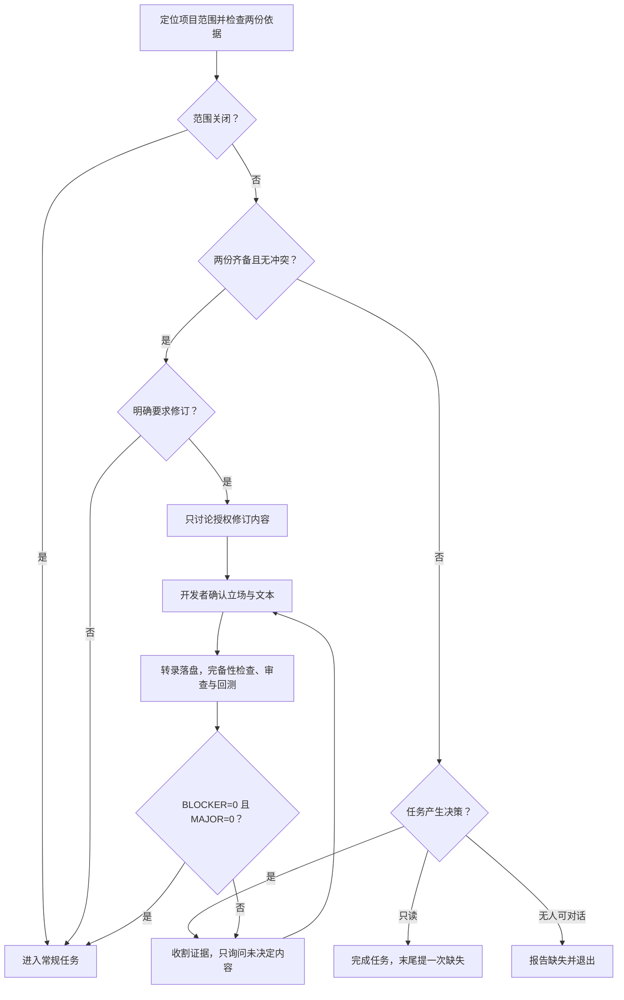

# 建立项目宪法与心智模型

宪法规定红线，心智模型为合法方案排序。立场由开发者决定，智能体负责收集证据、引导、转录已确认文本与检查，不根据仓库习惯推断价值条款。

## 何时使用

项目缺任一判断文件且当前任务会产生决策，或开发者明确要求建立、修订依据时使用。
已有依据齐备且覆盖当前任务时，直接遵守并继续常规流程；小改动、明确 bug 不重复初始化访谈。
“小改动”不能成为忽略红线或在依据缺失时自行豁免的理由。

## 第一步：定位与检查

DSH 通过 prompt section 每次装配读取；CodeBuddy、Claude Code、Codex 通过 SessionStart hook 注入。
检查上下文中的两个标记 `--- BEGIN CONSTITUTION.md ---` 与 `--- BEGIN MENTAL-MODEL.md ---`，以及缺失提示。
只有一个 BEGIN 标记不代表齐备。两份都已注入且没有缺失提示时直接使用，避免重复读文件。
`<FOUNDATION-LOCATION>` 表明依据所在目录，`&lt;...&gt;` 是被转义的原始正文标记。

上下文没有注入或怀疑文件已更新时，按以下与插件一致的规则定位，不只检查当前目录：

1. 从工作目录向上扫描，记住遇到的第一组依据所在目录，但继续检查祖先退出标记。
2. 当前层存在 `NO-CONSTITUTION.md` 常规文件时，范围关闭，不注入、不提示、不初始化。
3. 扫描到最近的 `.git` 文件或目录（含当前层）即止；不跨越 Git 边界。
4. 未关闭时读取最近一组依据；不把子层宪法与父层心智模型拼成一组。无依据则在当前目录报告缺失。
5. 空文件、纯空白、不可读或同名目录视为缺失；外层退出标记不影响嵌套 Git 仓库。

| 状态 | 动作 |
|---|---|
| 范围关闭 | 直接进入常规任务，不再要求建立依据 |
| 两份齐备且适用于当前项目 | 对照任务使用，不重写、不重新访谈 |
| 缺任一 | 先按第二步分流；需要补齐时只询问缺失或未决定的内容，保留已有文件 |
| 有矛盾或归属不明确 | 引用具体冲突与位置，请开发者裁决，不自行合并或修订 |
| 开发者明确要求修订 | 只处理授权范围，保留其余立场，确认文本后落盘 |

插件是建议器，不拦工具。“停”是智能体执行的规则，不是宿主机械阻断。
开发者显式豁免时，在本次产出中说明；智能体不得为了消除提示创建 `NO-CONSTITUTION.md`。

## 第二步：缺失时先分流

依据缺失不等于一律停下。先判断当前任务是否产生决策：

| 任务类型 | 例子 | 动作 |
|---|---|---|
| 只读 | 解释代码、回答问题、调研、总结 | 直接完成，在产出末尾提一次缺失，不重复提醒 |
| 产生决策或写入 | 新功能、重构、选型、改配置、改文档结构 | 先进入引导，再开工 |
| 无人可对话 | CI、批处理、无人值守 | 报告缺失并明确退出；不循环等待，不自行补文件 |

开发者显式要求跳过引导时，在本次产出中留痕后继续。

## 引导

目标：没写过宪法的开发者在十五分钟内拿到可用首版，之后按真实摩擦迭代。
一次问一个问题，优先提供 2–4 个可比较选项，允许自定义回答。首版访谈不超过 8 个问题，超出先落盘再迭代。
已确认的答案不重复询问。开发者直接口述条款时跳过访谈，只做转录与检查。

### 最小可用版本

| 文件 | 至少包含 |
|---|---|
| 宪法 | 3–7 条可判定的禁止；1 条修改权限（谁可以改、怎么留痕） |
| 心智模型 | 2–4 条决策轴及冲突时的偏向；1 组停止条件（哪些动作必须停下问人） |

达到即可落盘。不追求一次写全，缺口由后续「待裁决」补。

### 零、收割证据（智能体独立完成，不提问）

扫描 README、CONTRIBUTING、CLAUDE.md、AGENTS.md、SECURITY.md、LICENSE、CODEOWNERS、ADR 目录，以及提交信息中含「禁止」「绝不」「必须」的句子。
产出证据卡：原文、出处、以问句表达的候选解读。

三条界线：

- 已写下的规则是开发者先前的立场，可以引用并请其确认、归类。
- 观察到的事实（无测试、有 secrets 目录、依赖某框架）只能变成问题，不能变成条款。
- 把事实直接写成条款，或把技术栈与既有习惯升级为红线，是越权。

本公共技能及其示例不得混入使用者的内部路径、真实业务数据与私有假设。

### 一、定位（最多 3 问）

1. 交付形态：自用、团队还是公开开源？
2. 给谁用、用来做什么决策？这一项未明确前不写条款。
3. 出过什么真实事故或教训？事故是红线最可靠的来源。

### 二、红线（宪法）

请开发者列出 3–7 件绝不能发生的事，候选可来自证据卡。每条过三道测试，答案由开发者给出：

| 测试 | 问法 | 结果 |
|---|---|---|
| 事故测试 | 有人违反了，是回滚 / 拒绝合并，还是要求解释理由？ | 回滚进宪法；解释进心智模型 |
| 判定测试 | 第三人能否在一分钟内判断是否违反？ | 不能则请开发者改写 |
| 场景测试 | 举一个本项目会触发它的具体场景 | 举不出就不写 |

固定加入修改权限条款：谁可以改本文件、改动如何留痕。这是结构，不是价值观。

### 三、取舍（心智模型）

先呈现证据卡里暗示的冲突轴，再给扩展菜单。菜单只是示例，开发者可自定义：

| 候选轴 | 需要确定的取舍 |
|---|---|
| 完备 / 速度 | 多验证一轮还是先交付可用部分 |
| 简单 / 灵活 | 保持直接实现还是为已知场景扩展 |
| 可控 / 自动 | 哪些可逆动作可以自主，哪些必须人工裁决 |
| 严格 / 授权 | 哪些是不可豁免的约束，哪些允许显式授权例外 |
| 兼容 / 演进 | 保留旧接口还是允许破坏性变更 |
| 隐私 / 便利 | 数据留本地还是接入外部服务 |
| 性能 / 可读 | 优化热点还是保持直白实现 |
| 一致 / 局部最优 | 沿用项目惯例还是允许局部更好的做法 |

开发者选 2–4 条，每条说明冲突时偏向哪边、适用条件、一个例外。
不能只写“两边都要”。宪法先排除非法方案，心智模型再排序；普通偏好不能被误当作绝对禁令。

再单独确认停止条件：哪些动作必须停下问人。默认候选：删除、对外发布、修改治理文件、产生费用。

### 四、归属与邻居

1. 确认人是谁？团队项目写明，记入变更记录。
2. 现有指令文件（CLAUDE.md、AGENTS.md 等）与宪法冲突时谁赢？建议宪法赢，并在指令文件里加一行指向宪法，避免两套规则并行。

### 五、转录、检查、回测

开发者逐条确认条款含义与文本后，智能体原样转录并整理标题、表格等格式。
不得自行新增价值判断、改变适用条件；缺内容就问，不替人填。
开发者未确认前不写治理文件；修订只覆盖明确授权内容。仅缺一份时不重写另一份。

依次执行 `references/completeness-check.md` 与 `references/review-criteria.md`。
然后回测：从 git log 取最近两个有争议的改动，请开发者看两份文件能否判出结果。判不出记为缺口，由开发者决定补或留。
有缺陷时指出位置、后果与待裁决项，不自动重写。BLOCKER=0 且 MAJOR=0 才完成。

对已授权的修订，在项目现有变更记录中写明原因、范围、确认来源与验证，避免新建重复记录体系。
篇幅建议值：宪法 40 行、心智模型 70 行，由开发者在建立时确认。每条规则一句话，不写解释与重复；两份常驻注入，每行都是上下文成本。

### 六、演进

首版是草稿。后续遇到两份文件未覆盖的决策时，智能体在产出中给一条「待裁决」：遇到了什么、本次按什么处理、是否值得成为规则。只提议，不写入。
同类情况第二次出现且开发者批准，才进入修订。

持续精简：每次授权修订时顺带检查冗余。合并重复条款、删解释性文字、把多句规则压成一句，这些不改含义，可在开发者确认后一并转录。
接近上限先压缩再谈放宽；删规则或放宽上限由开发者裁决。

## 流程

## 决策证据与其他流程

重要判断使用审查判据中的最小证据表：规则位置与原文、候选方案及取舍、决定、验证。
输出无证据时明确“待验证”，不得把规则注入成功说成模型必然遵守。

核心能力独立可用。已安装 superpowers 可沿用其审查流程，未安装不阻断。
Spec Kit 等流程仍负责规格、计划、任务与实现；本技能不复制或接管这些流程。
