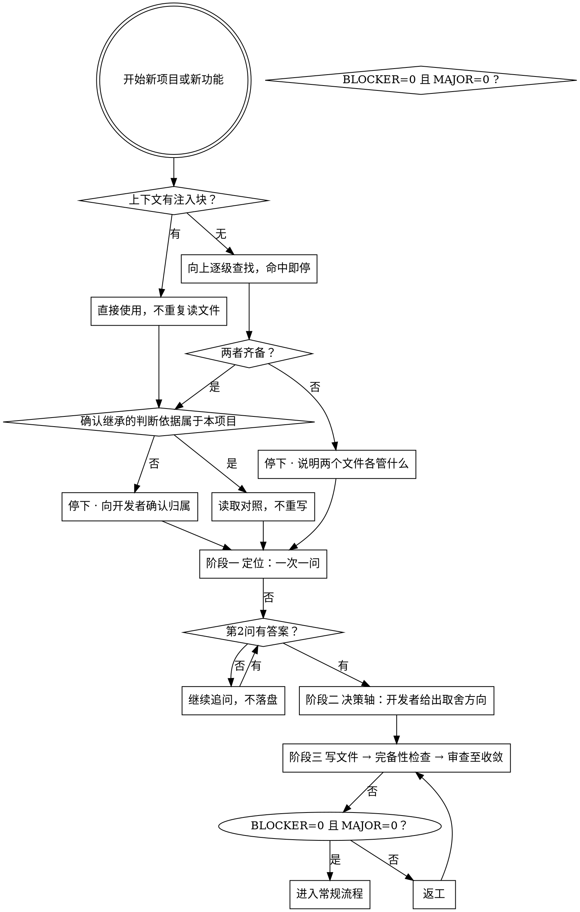

# 建立项目宪法与心智模型

## 概述

一个项目的**判断依据**必须先于**实施方案**存在。
宪法回答「什么能做、什么不能做」，心智模型回答「怎么决策」。
这两者只能由开发者本人给出 —— 它们是立场，不是推导结论。

**核心原则：缺判断依据时开工，等于在猜测的方向上加速。**

## 何时使用

新项目启动时，或要做一项重要新功能之前。

**不要用于**：小改动、修复明确 bug、已有判断依据覆盖范围内的常规任务。

## 第一步：检查，不是先写

**主路径**：判断依据已由 SessionStart hook 常驻注入。
上下文里出现 `--- BEGIN CONSTITUTION.md ---` 即表示已注入，**直接使用，不要重复读文件**。
注入块开头的 `<FOUNDATION-LOCATION>` 标明判断依据所在的项目根 —— 从子目录启动时，
规则属于该项目整体，不限于当前目录。

**兜底路径**（仅当上下文中没有注入块时使用）：

```bash
# 从当前位置向上查找，命中即停 —— 与 hook 的定位逻辑一致
d="$(pwd)"; while [ "$d" != "/" ] && [ ! -f "$d/CONSTITUTION.md" ] && [ ! -f "$d/MENTAL-MODEL.md" ]; do d="$(dirname "$d")"; done
ls "$d/CONSTITUTION.md" "$d/MENTAL-MODEL.md" 2>/dev/null
```

**不要用** `ls CONSTITUTION.md`（相对当前目录）—— 从子目录启动会误报缺失。

| 结果 | 动作 |
|---|---|
| 两者都在 | 读取并对照本次任务，**不重写**，进入常规流程 |
| 缺任一 | **停下**，告知开发者需要先补齐，进入引导流程 |
| 都缺 | 停下，说明两个文件分别管什么，引导完整建立 |

**继承语义**：向上查找意味着**子目录会继承最近的祖先判断依据**。
这是 monorepo 场景的期望行为，但嵌套的独立项目会静默继承外层规则 ——
若发现注入的判断依据不属于当前项目，停下向开发者确认，不要默认接受。

**「本次用不到」不构成跳过理由。** 判断依据的作用恰恰在于：
在你还没意识到需要它的时候拦住你。

## 引导流程

### 阶段一 · 定位（决定宪法的内容）

一次问一个问题，优先给选择题。不要一次抛出全部问题。

必问：
1. **交付形态** —— 自用 / 团队 / 公开开源？决定「绝不做」里能写什么
2. **给谁用、用来做什么决策** —— 用户拿这个工具做什么动作？答不上来定位就立不住
3. **最不能做错的一件事是什么** —— 直接产出宪法「绝不做」的核心
4. **有没有踩过坑的经历** —— 已有的教训比推演出的规则有用

**关键**：第 2 问得不到回答就不要往下走。
不知道用户拿它做什么，宪法写不出「不能做」，心智模型写不出「怎么决策」。

### 阶段二 · 决策轴（决定心智模型的内容）

呈现 2–4 条候选冲突，让开发者选或排序：

| 候选轴 | 冲突内容 |
|---|---|
| 完备 vs 速度 | 宁可多验证，还是先跑起来 |
| 灵活 vs 简单 | 预留扩展，还是保持最简 |
| 自动 vs 可控 | 智能体自主，还是每步问人 |
| 严格 vs 授权 | 严格守规则，还是给判断留余地 |

开发者**必须给出取舍方向**，不能两边都要。
两边都要等于没决策轴。

### 阶段三 · 落盘并审查

写入两个文件后，逐条走完备性检查（见 `references/completeness-check.md`），
再走审查判据（见 `references/review-criteria.md`）。

发现缺陷 → 提示开发者修订，**不代笔**。

## 硬性约束

| 约束 | 原因 |
|---|---|
| 一次只问一个问题 | 一次抛多个会导致开发者随便挑 |
| 只提供选择题，不开放式追问 | 降低回答成本 |
| 开发者未回答前不写文件 | 宁可等，不可猜 |
| 智能体不代笔任何一条 | 价值观是人的立场 |
| 不写入私有信息 | 不含真实项目名、内部路径、业务数据 |
| 篇幅上限：宪法 50 行，心智模型 100 行 | 超限时放宽上限，不砍内容 |

## 常见借口

这些都**不构成**跳过理由，遇到时停下并报告：

| 借口 | 为什么无效 |
|---|---|
| 「先做了再说，反正不冲突」 | 方向错了走得越快返工越多 |
| 「技术上很明显，不需要讨论」 | 技术清楚不等于该不该做清楚 |
| 「我知道要做什么」 | 知道要做什么，不需要宪法 |
| 「这次只是小改动」 | 小改动也可能触碰红线 |
| 「规则太严了」 | 严格是目的，不是意外 |

## 完整流程



## 常见错误

| 错误 | 后果 |
|---|---|
| 一次性抛十个问题 | 开发者随便挑，产出无意义 |
| 智能体替开发者写条款 | 产出开发者不认同的规则，后续必然绕过 |
| 只写宪法不写心智模型 | 有红线但没有决策方法，卡住即死锁 |
| 把技术选型写进宪法 | 宪法是红线，不是技术记录 |
| 文件写了不审查 | 规则自身矛盾，拦截能力为零 |

## 与其他流程的关系

本技能只负责**开工前的合法性检验**，不负责后续审查。

若已安装 `superpowers`，其两阶段审查可继续沿用，本技能不复述。
**未安装不影响使用** —— 审查由 `references/review-criteria.md` 的三档判据独立完成。